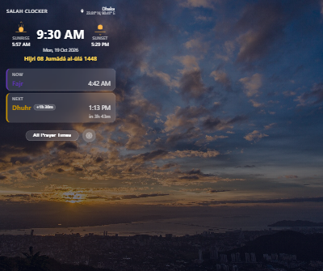
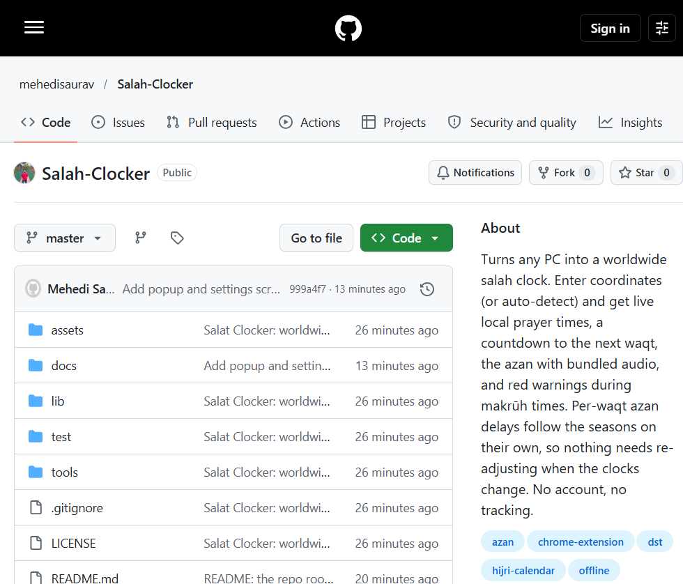
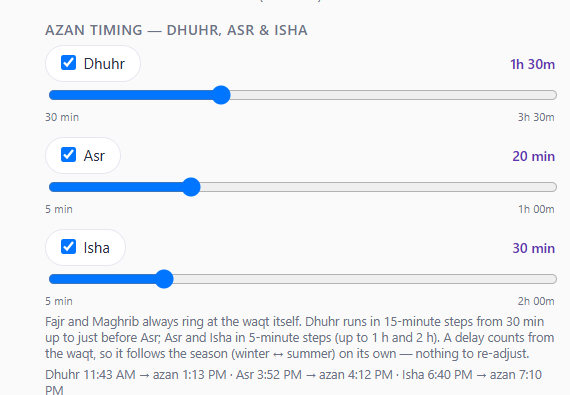

# Salat Clocker — Prayer Times & Azan

Turns any PC into a worldwide salah clock. Enter coordinates (or auto-detect)
and get live local prayer times, a countdown to the next waqt, the azan with
bundled audio, and red warnings during makrūh times. Per-waqt azan delays
follow the seasons on their own, so nothing needs re-adjusting when the
clocks change. No account, no tracking.



## Features

- **Anywhere on earth** — latitude/longitude (typed or auto-detected); the
  timezone is resolved from the coordinates and the city name is shown beside
  them.
- **Live clock** — the waqt you are in, the next one with a countdown, the Hijri
  date, and a sky background that follows the time of day.
- **Azan** — bundled audio, a notification, and the popup opens by itself, with
  snooze and stop.
- **Your own timing** — answer Dhuhr, Asr or Isha later if you wish: a slider
  per waqt (Dhuhr 30 min → just before Asr, Asr up to 1 h, Isha up to 2 h). A
  delay counts from the waqt, so it follows winter ↔ summer and the DST change
  by itself — nothing to re-adjust.
- **Makrūh times** — the sunrise, zawāl and sunset frames are flagged red, with
  the reason.
- **Daily hadith** — one during each azan, Arabic always, with English or
  Bangla translation.
- **No account, no tracking** — settings stay in the browser; the only network
  calls are the prayer-time, timezone, place-name and hadith lookups.

## Install on your PC

Works in Chrome, Edge, Brave and Opera (any Chromium browser). You load it as
an unpacked extension — no store account, no fee.

### 1. Get the folder

On this repo's page click the green **Code** button → **Download ZIP**, then
unzip it. (Or `git clone https://github.com/<you>/salat-clocker.git`.)

You should end up with a folder named `salat-clocker` that contains
`manifest.json` — remember where you unzipped it.



### 2. Open the extensions page

Type `chrome://extensions` in the address bar and press Enter.
(Edge: `edge://extensions` · Brave: `brave://extensions` · Opera: `opera://extensions`.)

### 3. Turn on Developer mode

Flip the **Developer mode** toggle in the top-right corner.


### 4. Load the extension

Click **Load unpacked** (top-left) and choose the `salat-clocker` folder — the
one that contains `manifest.json`, **not** its parent.


### 5. Pin it and set your location

Pin the extension from the puzzle-piece menu, click its icon, and set your
location — type coordinates, or press **My location** and allow geolocation.


That's it. The popup shows your local prayer times, the countdown to the next
waqt, and the azan fires at the waqt (or at your chosen delay).



## Using it

- **Location** — Settings → *Location — latitude & longitude*. The timezone and
  city name are resolved for you; saving clears them so the next lookup is fresh.
- **Azan timing** — Settings → *Azan timing — Dhuhr, Asr & Isha*. Tick a waqt and
  drag the slider. Dhuhr runs in 15-minute steps from 30 min up to just before
  Asr; Asr and Isha in 5-minute steps (up to 1 h and 2 h). Fajr and Maghrib
  always ring at the waqt. If the day's window has shrunk since you chose, the
  value stays and Settings warns you rather than changing it.
- **Remind before waqt** — a heads-up that many minutes before the azan.
- **Snooze, volume, theme, hadith language** — all on the same page.

## Updating

Re-download the ZIP (or `git pull`), unzip over the old folder, then click the
**reload arrow** on the extension's card at `chrome://extensions`.

## Removing

At `chrome://extensions`, click **Remove** on the extension's card.

## Troubleshooting

- **"Developer mode" warning strip** — normal for unpacked extensions; it
  appears because Developer mode is on.
- **Times are wrong or missing** — the extension needs internet for the
  prayer-time lookup (aladhan.com). Check the location and method in Settings.
- **No azan sound** — check the volume slider and that the tab isn't muted.
- **Alarms after a reboot** — Chrome fires overdue waqts on startup, within
  15 minutes of the waqt.

## For developers

```bash
node test/times.test.js   # prayer-time maths, delays, DST
node test/sw.test.js      # service-worker alarm harness
node test/hadith.test.js  # hadith fetch + rotation
```

`tools/` holds the dev-only scripts used to build the icons, sky photos and the
azan recording — not needed to run the extension.

## License

[MIT](LICENSE)
